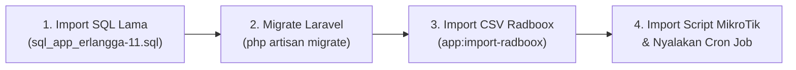

# ⚡ Panduan Singkat Migrasi ke Sistem Baru
## Menggunakan `sql_app_erlangga-11.sql` & `radboox_backup_11_10_2026.csv`

Dokumen ini adalah ringkasan cepat 4 langkah migrasi dari database app Erlangga lama dan backup Radboox ke sistem baru.

---

### 📊 Hasil Analisis File Anda

1. **`sql_app_erlangga-11.sql`** (Database App Lama):
   * Berisi **Akun Tim** (Admin, Teknisi, Sales), **1.990 Pelanggan fisik** (lengkap dengan SN modem ONT, ODP, foto instalasi), dan master lokasi.
   * *Status migrasi:* Berisi migrasi #1 sampai #25.

2. **`radboox_backup_11_10_2026.csv`** (Backup Radboox Berjalan):
   * Berisi **1.970 Akun PPPoE aktif** (username, password, IP framed).
   * Berisi **4.365 Faktur Tagihan / Invoices** (Rp 503.535.000).
   * Berisi **3.448 Riwayat Transaksi Pembayaran** (Rp 404.299.500).
   * Berisi **4 Paket Layanan** resmi.

---

### 🚀 4 Tahapan Singkat Eksekusi Migrasi



#### Langkah 1: Restore Database SQL App Lama
Import file `sql_app_erlangga-11.sql` ke database MySQL website Anda (misal `erlangga_billing`):
```bash
mysql -u root -p erlangga_billing < sql_app_erlangga-11.sql
```
*(Bisa juga di-import via menu Database > Import di phpMyAdmin / aaPanel).*

---

#### Langkah 2: Jalankan Migrasi Skema Baru
Jalankan migrasi Laravel untuk menambahkan tabel-tabel billing baru (`pppoes`, `invoices`, `transactions`, `pakets`, `settings`, dll):
```bash
cd /www/wwwroot/stage.erlangga.net
/www/server/php/82/bin/php artisan migrate --force
```
*Laravel otomatis melanjutkan migrasi dari #26 sampai selesai tanpa menghapus data lama.*

---

#### Langkah 3: Import Backup CSV Radboox & Sinkronkan FreeRADIUS
Jalankan perintah import satu baris ini di Terminal:
```bash
/www/server/php/82/bin/php artisan app:import-radboox --file=radboox_backup_11_10_2026.csv --sync-radius
```
*(Ketik `yes` saat diminta konfirmasi).*

**Apa yang otomatis terjadi:**
* 1.970 akun PPPoE dari Radboox otomatis **dicocokkan (*Smart Match*)** ke 1.990 data pelanggan lama (SN modem dan profil tetap utuh).
* Seluruh 4.365 faktur tagihan dan 3.448 transaksi keuangan langsung terhubung ke pelanggan.
* Seluruh username & password PPPoE otomatis di-sync ke FreeRADIUS (`radcheck` & `radreply`).

---

#### Langkah 4: Terapkan Script ke MikroTik & Aktifkan Cron Job
1. **MikroTik RouterOS**:
   * Buka web app menu **Pengaturan Sistem** &gt; tab **Script MikroTik** &gt; klik tombol **Unduh .rsc** (tab All-in-One).
   * Drag file `full-setup-pnp.rsc` ke menu **Files** di Winbox.
   * Di terminal Winbox ketik: `/import full-setup-pnp.rsc`.
2. **Cron Job aaPanel**:
   * Masuk ke menu **Cron** aaPanel &gt; buat tugas setiap 1 menit:
     ```bash
     /www/server/php/82/bin/php /www/wwwroot/stage.erlangga.net/artisan schedule:run >> /dev/null 2>&1
     ```

---

### ✅ Selesai!
Sistem billing baru Anda kini sudah beroperasi penuh dengan seluruh data pelanggan lama, histori keuangan Radboox, dan otomasi penagihan/isolir.
