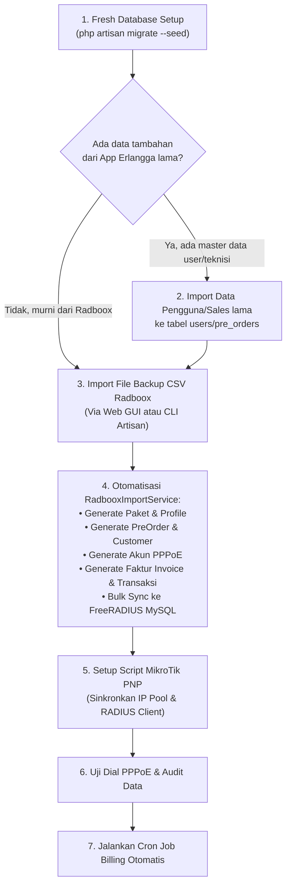

# 📦 Panduan Lengkap Migrasi dari Radboox ke Sistem Billing Erlangga Net
## Web App Erlangga Net Management System (`app-erlangga-net`)

Dokumentasi ini menjelaskan secara rinci alur, tahapan, dan instruksi teknis untuk memindahkan seluruh data operasional dari **Radboox** (atau aplikasi Erlangga versi lama) ke sistem manajemen billing terintegrasi yang baru.

---

## 📑 Daftar Isi
1. [Prinsip & Hirarki Sumber Data (Source of Truth)](#1-prinsip--hirarki-sumber-data-source-of-truth)
2. [Alur Urutan Migrasi yang Benar](#2-alur-urutan-migrasi-yang-benar)
3. [Langkah 1: Persiapan Skema Database Baru](#3-langkah-1-persiapan-skema-database-baru)
4. [Langkah 2: Ekspor Data Backup dari Radboox](#4-langkah-2-ekspor-data-backup-dari-radboox)
5. [Langkah 3: Menjalankan Import Data](#5-langkah-3-menjalankan-import-data)
   - [Opsi A: Melalui Web GUI Dashboard (Mudah & Visual)](#opsi-a-melalui-web-gui-dashboard-menu-backup--restore)
   - [Opsi B: Melalui Terminal CLI (Rekomendasi untuk File Besar / Ribuan Akun)](#opsi-b-melalui-terminal-cli-aapanel-rekomendasi-ribuan-akun)
6. [Langkah 4: Sinkronisasi FreeRADIUS & MikroTik RouterOS](#6-langkah-4-sinkronisasi-freeradius--mikrotik-routeros)
7. [Langkah 5: Verifikasi & Audit Pasca-Migrasi](#7-langkah-5-verifikasi--audit-pasca-migrasi)
8. [Langkah 6: Mengaktifkan Siklus Billing & Cron Job Otomatis](#8-langkah-6-mengaktifkan-siklus-billing--cron-job-otomatis)
9. [Tanya Jawab & Troubleshooting Migrasi](#9-tanya-jawab--troubleshooting-migrasi)

---

## 1. Prinsip & Hirarki Sumber Data (Source of Truth)

> [!IMPORTANT]
> **Menjawab Pertanyaan: Import App Erlangga Lama dulu, CSV Radboox, atau Migrate dulu?**
>
> 1. **Database Skema Baru WAJIB dimigrasikan pertama kali (`php artisan migrate`)** agar seluruh struktur tabel (`customers`, `pppoes`, `invoices`, `transactions`, `pakets`) sudah siap menerima data.
> 2. **File CSV Radboox adalah Sumber Utama (*Single Source of Truth*)** jika operasional internet Anda sebelumnya berjalan di Radboox. File CSV Radboox telah mencakup:
>    - Master Paket Layanan (Type 2)
>    - Akun Pelanggan, No WA, Alamat, Username & Password PPPoE, IP Static (Type 6)
>    - Riwayat Faktur / Invoice Bulanan (Type 5)
>    - Riwayat Transaksi Pembayaran Kasir / Bank (Type 4)
> 3. **Bagaimana jika ada data dari App Erlangga lama?**
>    - Jika di app Erlangga lama Anda memiliki data akun Petugas Sales, Teknisi, atau data pendaftaran PreOrder yang belum ada di Radboox: **Data app Erlangga lama dapat diimpor terlebih dahulu**.
>    - Sistem baru dilengkapi fitur **Smart Multi-Field Matching**: Saat file CSV Radboox diimpor setelahnya, sistem otomatis mencocokkan data berdasarkan **Username PPPoE, Nomor WhatsApp, Nama Pelanggan, atau NIK**. Jika pelanggan sudah ada, sistem hanya akan memperbarui/menghubungkan akunnya tanpa membuat duplikasi data!

---

## 2. Alur Urutan Migrasi yang Benar



---

## 3. Langkah 1: Persiapan Skema Database Baru

Sebelum memasukkan data apapun, pastikan skema database utama dan database FreeRADIUS sudah bersih dan termigrasi dengan benar.

Buka Terminal server / aaPanel, jalankan perintah:

```bash
cd /www/wwwroot/stage.erlangga.net

# 1. Pastikan seluruh tabel termigrasi
/www/server/php/82/bin/php artisan migrate

# 2. (Opsional) Jalankan seeder admin awal jika instalasi baru
/www/server/php/82/bin/php artisan db:seed
```

> [!TIP]
> Jika sebelumnya Anda telah mencoba memasukkan data uji coba / dummy dan ingin memulai dari kondisi bersih, Anda dapat menggunakan fitur **Reset & Kosongkan Data** pada menu Web GUI **Backup & Restore Data** (`/migration`), atau jalankan seeder paket standar.

---

## 4. Langkah 2: Ekspor Data Backup dari Radboox

1. Buka dashboard aplikasi **Radboox** lama Anda sebagai Administrator.
2. Masuk ke menu **Pengaturan / Tools** &gt; **Backup Database**.
3. Pilih opsi ekspor / cadangkan seluruh data ke format file **`.CSV`**.
4. Unduh file tersebut ke komputer Anda (biasanya bernama `radboox_backup_MM_DD_YYYY.csv`).

File CSV standar Radboox memiliki penanda baris angka di kolom pertama:
* Baris berawalan `1`: Data NAS Router / Client RADIUS
* Baris berawalan `2`: Data Paket Layanan / Profile Internet
* Baris berawalan `6`: Data Akun PPPoE, Pelanggan, Password, IP Static, Alamat, dan Kontak
* Baris berawalan `5`: Data Tagihan / Faktur Invoice (Lunas & Belum Lunas)
* Baris berawalan `4`: Data Riwayat Transaksi Pembayaran

---

## 5. Langkah 3: Menjalankan Import Data

Sistem menyediakan 2 metode import: melalui **Web GUI** (sangat praktis) dan melalui **Terminal CLI** (sangat cepat untuk data berukuran besar).

### Opsi A: Melalui Web GUI Dashboard (Menu Backup & Restore)

Cocok untuk file backup hingga puluhan megabyte:

1. Login ke aplikasi Erlangga Net sebagai **Administrator**.
2. Buka menu sidebar kiri &gt; **Backup & Restore Data** (URL: `/migration`).
3. Perhatikan seksi **"2. Pulihkan / Import Full Backup Sistem"**:
   - Klik **Pilih File Backup CSV (.csv)** dan pilih file `radboox_backup_*.csv` dari komputer Anda.
   - Pastikan opsi berikut dicentang:
     - [x] **Sinkronkan ke Database RADIUS** *(Otomatis mengisi tabel radcheck, radreply, radusergroup, userinfo)*
     - [x] **Import Faktur / Invoice Tagihan** *(Memindahkan invoice aktif & riwayat tagihan pelanggan)*
     - [x] **Import Riwayat Transaksi Pembayaran** *(Memindahkan catatan pembayaran lunas pelanggan)*
4. Klik tombol **Pulihkan Full Backup**.
5. Tunggu hingga proses selesai (sistem telah diatur dengan batas waktu eksekusi hingga 10 menit). Setelah selesai, pesan sukses berisi rincian akun baru, faktur, dan transaksi akan muncul.

---

### Opsi B: Melalui Terminal CLI aaPanel (Rekomendasi Ribuan Akun)

Jika pelanggan Anda berjumlah ribuan dan file CSV cukup besar, eksekusi melalui baris perintah (*CLI*) jauh lebih cepat, stabil, dan tidak bergantung pada timeout browser:

1. **Unggah file CSV Radboox ke server VPS**:
   Buka menu **Files** di aaPanel &gt; masuk ke folder `/www/wwwroot/stage.erlangga.net/backup/` (jika folder `backup` belum ada, buat folder baru) &gt; klik **Upload** dan letakkan file CSV Anda di sana (misal dinamai `radboox_backup.csv`).

2. **Buka Terminal aaPanel dan jalankan perintah import**:
   ```bash
   cd /www/wwwroot/stage.erlangga.net

   # Jalankan perintah import dengan sinkronisasi RADIUS
   /www/server/php/82/bin/php artisan app:import-radboox --file=backup/radboox_backup.csv --sync-radius
   ```

3. **Interaksi Terminal**:
   - Terminal akan menganalisis file dan menampilkan tabel ringkasan:
     ```text
     =================================================
          RADBOOX BACKUP MIGRATION & SYNC TOOL        
     =================================================
     File: backup/radboox_backup.csv

     Menganalisis file backup...
     +-------------------------+---------------+-----------------------------+
     | Entitas                 | Jumlah Record | Keterangan                  |
     +-------------------------+---------------+-----------------------------+
     | Paket Layanan           | 4             | Paket internet              |
     | Akun PPPoE & Pelanggan  | 520           | Akun & Profil Pelanggan     |
     | Faktur / Invoice        | 2.450         | Total: Rp 342.150.000       |
     | Riwayat Transaksi       | 2.100         | Total: Rp 310.800.000       |
     +-------------------------+---------------+-----------------------------+

     Apakah Anda yakin ingin memulai proses import & sinkronisasi data ke database? (yes/no) [yes]:
     ```
   - Ketik `yes` lalu tekan **Enter**.
   - Terminal akan menampilkan progress bar secara realtime hingga seluruh data berhasil diimpor.

---

## 6. Langkah 4: Sinkronisasi FreeRADIUS & MikroTik RouterOS

Setelah data berhasil masuk ke database MySQL:

### A. Memverifikasi Database FreeRADIUS
Jika opsi `--sync-radius` digunakan, data autentikasi otomatis masuk ke database FreeRADIUS. Anda dapat memastikan bahwa akun sudah tersinkronisasi:
```bash
/www/server/php/82/bin/php artisan radius:sync
```
Perintah di atas dapat dijalankan kapan saja jika Anda ingin memvalidasi ulang seluruh user PPPoE ke tabel FreeRADIUS (`radcheck`, `radreply`, `radusergroup`).

### B. Menerapkan Konfigurasi Plug & Play ke Router MikroTik
1. Buka dashboard web app &gt; menu **Pengaturan Sistem** &gt; tab **Script MikroTik**.
2. Di sana telah tersedia script RouterOS yang disesuaikan otomatis dengan IP server RADIUS dan daftar paket layanan yang baru diimpor.
3. Klik tombol **Unduh .rsc** pada tab **5. Script Lengkap (All-in-One)** (menghasilkan file `full-setup-pnp.rsc`).
4. Buka aplikasi **Winbox**:
   - Drag file `full-setup-pnp.rsc` ke menu **Files** di Winbox.
   - Buka **New Terminal** di Winbox, lalu ketik:
     ```routeros
     /import full-setup-pnp.rsc
     ```
   - Seluruh IP Pool, Profile PPP, RADIUS Client, Incoming CoA (Disconnect Port 3799), API User, dan Firewall NAT Isolir otomatis aktif di MikroTik!

---

## 7. Langkah 5: Verifikasi & Audit Pasca-Migrasi

Lakukan pengecekan acak untuk memastikan integritas data:

1. **Menu Pelanggan & PPPoE (`/customers` & `/pppoe`)**:
   - Pastikan total pelanggan aktif cocok dengan data di Radboox.
   - Cek beberapa pelanggan: pastikan nomor WhatsApp, alamat, username PPPoE, dan paket langganannya sesuai.
2. **Menu Faktur & Invoice (`/invoices`)**:
   - Pastikan invoice bulan berjalan terdata dengan benar.
   - Pelanggan yang sudah membayar di Radboox berstatus **PAID (Lunas)**.
   - Pelanggan yang belum membayar berstatus **UNPAID (Belum Bayar)**.
3. **Menu Transaksi (`/transactions`)**:
   - Pastikan riwayat pembayaran kasir dan mutasi keuangan terekam dengan nilai nominal yang tepat.
4. **Pengujian Sambungan PPPoE**:
   - Uji coba dial PPPoE salah satu pelanggan (atau router lab pengujian) mengarah ke server FreeRADIUS baru.
   - Pastikan koneksi berhasil terotentikasi (*Connected*) dan pelanggan mendapatkan IP sesuai paketnya.

---

## 8. Langkah 6: Mengaktifkan Siklus Billing & Cron Job Otomatis

Setelah migrasi dinyatakan valid, aktifkan otomasi billing di server VPS aaPanel agar penagihan dan isolir berjalan otomatis tanpa intervensi manual.

1. Buka dashboard aaPanel &gt; menu **Cron**.
2. Tambahkan Cron Job baru:
   - **Type of Task:** Shell Script
   - **Name of Task:** Laravel Scheduler Erlangga Net
   - **Period:** N Minutes / Every 1 Minute (`* * * * *`)
   - **Script content:**
     ```bash
     /www/server/php/82/bin/php /www/wwwroot/stage.erlangga.net/artisan schedule:run >> /dev/null 2>&1
     ```
3. Klik **Add task**.

#### Siklus yang Otomatis Berjalan:
* **Setiap Tanggal 1**: Sistem otomatis menerbitkan (*generate*) invoice tagihan bulan berjalan untuk semua pelanggan aktif (7 hari sebelum jatuh tempo tanggal 8).
* **Setiap Hari Pukul 00:05**: Sistem mengecek pelanggan yang telah melewati batas jatuh tempo (tanggal 8). Jika belum lunas, status otomatis diubah menjadi **ISOLIR**, pool IP di router dipindahkan ke `pool-isolir`, dan session di-kick via RADIUS CoA sehingga koneksi langsung terisolir ke portal pembayaran.
* **Saat Pembayaran Masuk (Xendit / Kasir)**: Invoice langsung lunas, pelanggan otomatis dipulihkan (*un-isolir*), dan session PPPoE di-refresh kembali ke profil normal.

---

## 9. Tanya Jawab & Troubleshooting Migrasi

### Q: Apa yang terjadi jika file CSV Radboox diimpor dua kali?
**A:** Tidak akan terjadi duplikasi data. Sistem menggunakan mekanisme **Upsert & Smart Matching**. Jika username PPPoE atau pelanggan sudah ditemukan di database, sistem hanya akan memperbarui data tersebut dan tidak membuat baris baru.

### Q: Bagaimana jika ada paket di Radboox yang namanya sedikit berbeda dengan paket baru?
**A:** `RadbooxImportService` memiliki sistem pencocokan toleran (*fuzzy mapping*). Sebagai contoh:
* `Paket 10 Mbps`, `10M`, `Bronze`, `Paket Bronze 112K` otomatis dipetakan ke **Paket Bronze 112K**.
* `Paket 20 Mbps`, `20M`, `Silver`, `Paket Silver 179K` otomatis dipetakan ke **Paket Silver 179K**.
* Jika ada paket baru yang benar-benar tidak dikenal, sistem otomatis membuatkan entri paket baru dengan rate-limit dan harga sesuai data dari Radboox.

### Q: Apakah password PPPoE pelanggan di Radboox tetap sama setelah migrasi?
**A:** **Ya, 100% sama.** Password PPPoE dipindahkan persis seperti di Radboox dan disinkronkan ke tabel `radcheck` FreeRADIUS dengan atribut `Cleartext-Password`, sehingga modem ONT / router di rumah pelanggan tidak perlu di-setting ulang.

### Q: Mengapa upload CSV via Web gagal dengan pesan "File too large" atau 413 Request Entity Too Large?
**A:** Batasan upload Nginx / PHP di aaPanel belum disesuaikan. Pastikan `upload_max_filesize` dan `post_max_size` di PHP Setting aaPanel sudah dinaikkan ke **50M** atau **100M**, atau gunakan **Opsi B (Terminal CLI)** yang tidak dibatasi oleh batas upload web server.
